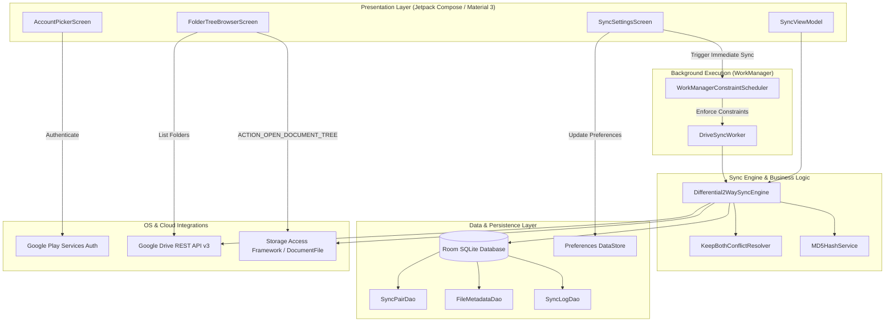

# Coincide Drive: Native Android 2-Way Sync Architecture & Design Specification

> **Project Name:** Coincide Drive  
> **Target OS:** Android 14+ (API 34, Min API 26)  
> **UI Framework:** Jetpack Compose with Material Design 3 (Material You)  
> **Stitch Project ID:** `11524150199341713974`  
> **Design System Asset:** `assets/dc7a674a75a54acc85b9e21e6ae61b4b` (Tonal Material Workspace)  

---

## 1. System Overview

**Coincide Drive** is a native Android application designed to perform seamless, bidirectional (2-way) synchronization between selected Google Drive remote folders and public local device directories (such as `/Documents/ObsidianVault`). 

### Core Pillars
1. **Zero-Friction Authentication:** Leverages Google Play Services on-device account picker (no custom in-app web OAuth forms).
2. **Public Local Storage Access:** Uses the Android Storage Access Framework (`ACTION_OPEN_DOCUMENT_TREE`) with persistable URI permissions so external productivity apps (e.g., Obsidian, Logseq, text editors) can read and modify files concurrently.
3. **Lossless "Keep Both" Conflict Resolution:** When a file is modified both remotely and locally since the last sync baseline, the incoming Drive file is renamed to `filename_conflict_YYYYMMDD_HHMMSS.ext`. Data is never silently overwritten or deleted.
4. **Resilient Background Execution:** Powered by Android `WorkManager` honoring strict battery and network constraints configured by the user.

---

## 2. Stitch UI Wireframes & Design Specifications

The user interface follows the **Tonal Material Workspace** design system generated via the Stitch MCP, adhering strictly to Android Material 3 (Material You) dynamic tonal styling, pill profiles (`rounded-full`), and 8dp spatial rhythm.

### Screen 1: Account Picker & Authentication
* **Stitch Screen ID:** `0b7315423f4540869d130d1a1acf16d2`
* **Wireframe Preview:** 
* **Key Components & User Flow:**
  1. **Top App Bar:** Coincide Drive brand logo and security status.
  2. **Active Google Account Card:** Displays active user profile picture, display name, and email with a **Google Play Services Verified** badge.
  3. **Drive Storage Quota Bar:** Visual progress meter indicating used vs. total Google Drive storage.
  4. **Account Switcher:** Tonal button triggering `GoogleSignInClient.signInIntent` or the Play Services credential picker.
  5. **Permission Status Checklist:** Visual status cards for Google Drive Access (`https://www.googleapis.com/auth/drive.file`), WorkManager background service, and Local Storage Access Framework (SAF).
  6. **Bottom Action Bar:** Sticky filled pill button `Continue to Folder Sync Setup`.

---

### Screen 2: Folder Tree Browser & Sync Pair Setup
* **Stitch Screen ID:** `604ef9aba4ab4934b15b5841bd80a058`
* **Wireframe Preview:** 
* **Key Components & User Flow:**
  1. **Step Indicator:** `Step 2 of 3: Folder Mapping`.
  2. **Drive Folder Tree Browser:** Expandable folder hierarchy querying Google Drive REST API (`mimeType = 'application/vnd.google-apps.folder' and trashed = false`), showing folder names, item counts, and selection radio buttons.
  3. **Android Storage Access Framework (SAF) Card:** 
     - Button triggering `Intent(Intent.ACTION_OPEN_DOCUMENT_TREE)` with `Intent.FLAG_GRANT_PERSISTABLE_URI_PERMISSION | Intent.FLAG_GRANT_READ_URI_PERMISSION | Intent.FLAG_GRANT_WRITE_URI_PERMISSION`.
     - Displays formatted URI breadcrumb (e.g., `Primary Storage > Documents > ObsidianVault`).
     - Explanatory footnote highlighting compatibility with external editors.
  4. **Bidirectional Mapping Visualization:** Graphical card depicting `[Drive / ObsidianVault] <== 2-Way Sync ==> [Local / Documents / ObsidianVault]`.
  5. **Conflict Resolution Card:** Explicit "Keep Both (Enforced)" badge explaining that file clashes produce `filename_conflict_YYYYMMDD_HHMMSS.ext`.
  6. **Bottom Action Bar:** Sticky CTA button `Save & Continue to Settings`.

---

### Screen 3: Sync Engine Settings & Constraints
* **Stitch Screen ID:** `6baced55c6ec4ce9ab28daa555c2a294`
* **Wireframe Preview:** 
* **Key Components & User Flow:**
  1. **Hero Status & Immediate Sync Card:**
     - Live state badge: `Idle (WorkManager Scheduled)` or `Syncing (45%)`.
     - Last sync timestamp & file count summary.
     - `Sync Now` manual trigger button executing an immediate `OneTimeWorkRequest`.
  2. **WorkManager Constraint Toggles:**
     - `Wi-Fi only` -> `NetworkType.UNMETERED`
     - `Allow Mobile Data` -> Enables cellular fallback if Wi-Fi only is off
     - `Block Roaming Data` -> `NetworkType.NOT_ROAMING`
     - `Only when charging` -> `setRequiresCharging(true)`
  3. **Periodic Sync Frequency Selector:**
     - Segmented interval chips: `15 min` (WorkManager minimum), `30 min`, `1 hour` (Recommended default), `6 hours`, `Daily (24h)`, and `Manual Only`.
  4. **Storage & Diagnostics Card:**
     - Room SQLite index statistics (`142 files indexed, hashes verified`).
     - Quick action: `Clear Cache & Re-index`.
  5. **Bottom Sticky Action:** `Apply & Schedule WorkManager`.

---

## 3. Technical Architecture & Component Interaction



---

## 4. 2-Way Sync Engine & Conflict Resolution Specification

### 4.1 State Matrix & Differential Detection
The sync engine maintains a baseline snapshot of all synced items in the Room database (`file_metadata` table). Every sync cycle runs a 3-way differential comparison between:
- **Remote State:** Google Drive metadata (`id`, `name`, `modifiedTime`, `md5Checksum`).
- **Local State:** SAF `DocumentFile` metadata (`uri`, `name`, `lastModified`, calculated MD5 hash).
- **Baseline Snapshot (Database):** State recorded during the previous successful sync (`lastKnownRemoteMd5`, `lastKnownLocalMd5`, `lastSyncTimestamp`).

| Case | Remote State | Local State | Action Taken |
| :--- | :--- | :--- | :--- |
| **A** | Modified (Hash Changed) | Unchanged | **Download:** Overwrite local file with Drive version, update DB baseline. |
| **B** | Unchanged | Modified (Hash Changed) | **Upload:** Upload new local version to Drive, update DB baseline. |
| **C** | New file created | Does not exist | **Download:** Create file in local SAF directory, insert DB baseline. |
| **D** | Does not exist | New file created | **Upload:** Create file on Google Drive, insert DB baseline. |
| **E** | Deleted | Unchanged | **Propagate Delete:** Delete local file, remove DB baseline. |
| **F** | Unchanged | Deleted | **Propagate Delete:** Trash Drive file, remove DB baseline. |
| **G (Conflict)** | Modified | Modified (Hashes differ) | **"Keep Both" Strategy:** Resolve conflict non-destructively. |

### 4.2 "Keep Both" Resolution Algorithm
When Case G occurs:
1. The local file is left untouched as the local master (`filename.ext`).
2. Generate a conflict timestamp string: `val timestamp = SimpleDateFormat("yyyyMMdd_HHmmss", Locale.US).format(Date())`.
3. Compute conflict filename:
   ```kotlin
   val nameWithoutExt = originalName.substringBeforeLast(".")
   val ext = originalName.substringAfterLast(".", "")
   val conflictName = if (ext.isNotEmpty()) {
       "${nameWithoutExt}_conflict_${timestamp}.${ext}"
   } else {
       "${nameWithoutExt}_conflict_${timestamp}"
   }
   ```
4. Download the Drive version as a new file named `conflictName` into the local SAF folder.
5. Create a new Drive entry for `conflictName` containing the downloaded content (or upload the local conflict file) so both files exist in both locations.
6. Insert database records for both files and mark the conflict event in `sync_logs`.

---

## 5. Storage Access Framework (SAF) Implementation

Because Android 10+ enforces Scoped Storage, accessing shared folders (such as `/Documents/ObsidianVault`) must be performed via SAF:
1. **Directory Selection Intent:**
   ```kotlin
   val intent = Intent(Intent.ACTION_OPEN_DOCUMENT_TREE).apply {
       flags = Intent.FLAG_GRANT_READ_URI_PERMISSION or
               Intent.FLAG_GRANT_WRITE_URI_PERMISSION or
               Intent.FLAG_GRANT_PERSISTABLE_URI_PERMISSION
   }
   launcher.launch(intent)
   ```
2. **Persisting Permissions Across Reboots:**
   ```kotlin
   context.contentResolver.takePersistableUriPermission(
       treeUri,
       Intent.FLAG_GRANT_READ_URI_PERMISSION or Intent.FLAG_GRANT_WRITE_URI_PERMISSION
   )
   ```
3. **I/O Operations:** Handled through `DocumentFile.fromTreeUri(context, treeUri)` and `contentResolver.openInputStream(uri)` / `openOutputStream(uri)`.

---

## 6. Room Database Schema

```sql
-- Sync Pairs (Mapping between Drive Folder and Local SAF Directory)
CREATE TABLE sync_pairs (
    id TEXT PRIMARY KEY NOT NULL,
    account_email TEXT NOT NULL,
    remote_folder_id TEXT NOT NULL,
    remote_folder_name TEXT NOT NULL,
    local_tree_uri TEXT NOT NULL,
    local_display_path TEXT NOT NULL,
    sync_direction TEXT NOT NULL DEFAULT 'BIDIRECTIONAL',
    is_active INTEGER NOT NULL DEFAULT 1,
    created_at INTEGER NOT NULL
);

-- File Metadata Snapshot (Baseline for differential sync)
CREATE TABLE file_metadata (
    id TEXT PRIMARY KEY NOT NULL,
    pair_id TEXT NOT NULL,
    relative_path TEXT NOT NULL,
    file_name TEXT NOT NULL,
    remote_file_id TEXT,
    remote_md5 TEXT,
    remote_modified_time INTEGER NOT NULL,
    local_uri TEXT,
    local_md5 TEXT,
    local_modified_time INTEGER NOT NULL,
    last_sync_time INTEGER NOT NULL,
    sync_status TEXT NOT NULL, -- 'SYNCED', 'CONFLICT', 'PENDING'
    FOREIGN KEY(pair_id) REFERENCES sync_pairs(id) ON DELETE CASCADE
);

-- Sync Execution Logs
CREATE TABLE sync_logs (
    id INTEGER PRIMARY KEY AUTOINCREMENT NOT NULL,
    pair_id TEXT NOT NULL,
    timestamp INTEGER NOT NULL,
    files_uploaded INTEGER NOT NULL,
    files_downloaded INTEGER NOT NULL,
    conflicts_resolved INTEGER NOT NULL,
    status TEXT NOT NULL, -- 'SUCCESS', 'FAILED', 'CANCELLED'
    error_message TEXT,
    duration_ms INTEGER NOT NULL
);
```

---

## 7. WorkManager Constraints & Scheduler Mapping

The UI toggles map directly to Android `androidx.work.Constraints`:

```kotlin
fun buildSyncConstraints(settings: SyncSettings): Constraints {
    val networkType = when {
        settings.wifiOnly -> NetworkType.UNMETERED
        settings.blockRoaming -> NetworkType.NOT_ROAMING
        settings.allowMobileData -> NetworkType.CONNECTED
        else -> NetworkType.CONNECTED
    }

    return Constraints.Builder()
        .setRequiredNetworkType(networkType)
        .setRequiresCharging(settings.onlyWhenCharging)
        .setRequiresBatteryNotLow(true)
        .build()
}
```

Periodic syncing is scheduled using `PeriodicWorkRequestBuilder<DriveSyncWorker>(intervalMinutes, TimeUnit.MINUTES)` with unique work name `coincide_drive_periodic_sync` and `ExistingPeriodicWorkPolicy.UPDATE`.

---

## 8. Multi-Agent Orchestration Plan (Phase 2)

Upon user approval of this architecture document and the Stitch wireframes, three parallel sub-agents will be launched:

| Agent | Role | Responsibilities | Target Deliverables |
| :--- | :--- | :--- | :--- |
| **Agent 1** | **Mobile UI Engineer** | Jetpack Compose screens for Account Picker, Folder Tree Browser, and Settings based on approved Stitch designs. SAF Intent launcher and persistable URI permissions handler. | `ui/`, `AccountPickerScreen.kt`, `FolderBrowserScreen.kt`, `SettingsScreen.kt`, `NavGraph.kt` |
| **Agent 2** | **Drive Integration Specialist** | Google Sign-In via Play Services (`GoogleSignInClient` / Credential Manager), Google Drive REST API v3 client, differential 2-way sync engine, and "Keep Both" conflict resolver. | `drive/`, `GoogleAuthManager.kt`, `DriveRepository.kt`, `DifferentialSyncEngine.kt`, `KeepBothConflictResolver.kt` |
| **Agent 3** | **System Background Engineer** | Room Database (Entities, DAOs, Database migrations), Preferences DataStore, WorkManager `DriveSyncWorker`, Constraints Builder, and periodic scheduling. | `data/`, `AppDatabase.kt`, `Daos.kt`, `work/`, `DriveSyncWorker.kt`, `SyncScheduler.kt`, `SyncPreferences.kt` |

---
*Generated by Lead Product Designer for Coincide Drive. Awaiting review and approval.*
